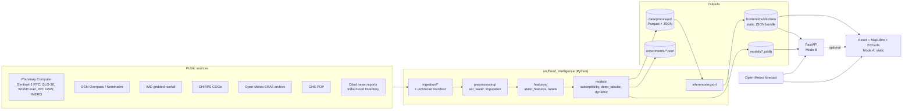
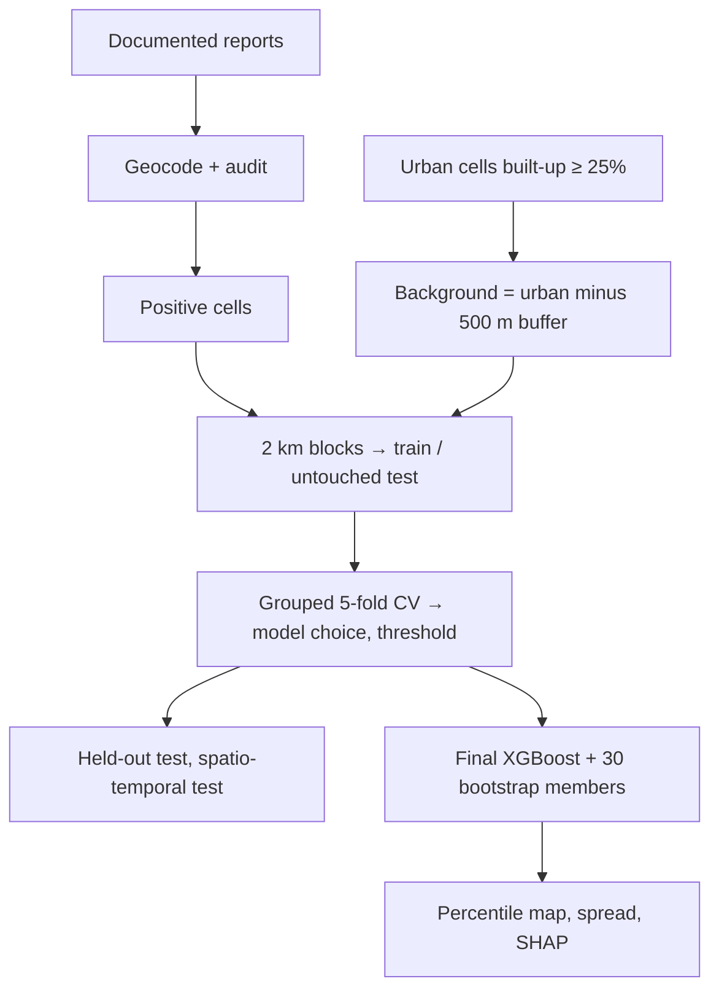

# Architecture

A modular monolith: one Python package for the research pipeline, a thin FastAPI service, and a static React site.

**Operating modes.** *Mode A* (default, GitHub Pages): all pages read precomputed JSON with generation timestamps; the
Live page calls Open-Meteo directly from the browser and evaluates the exported logistic model client-side. *Mode B*:
when `VITE_API_BASE` points to a running API, the cell panel requests a fresh TreeSHAP decomposition, and
`/api/flood/risk` and `/api/flood/forecast` provide server-side inference. If the API is unreachable the UI says so and
falls back to Mode A.

**City registry.** `config/cities.yaml` drives every stage (bbox, UTM zone, status). Adding a city = registry entry +
observation inventory + `scripts/run_pipeline.sh <city>`. A city appears as selectable only when its outputs exist.
